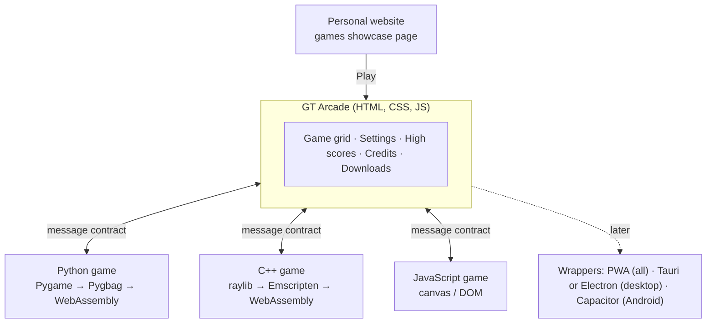

# Architecture

GT Arcade is a **web hub with game modules**. The hub is a small HTML, CSS and JavaScript app. Each game runs inside a frame and talks to the hub through a small message contract, so a game can be written in any language that can run in the browser.

## Responsibilities

| Part | Owns |
|---|---|
| Hub | Game selection, loading screen, settings (sound, controls), high scores, credits, download links |
| Each game | Gameplay plus a minimal pause and game-over state; runs inside a frame |
| Message contract | The only link between hub and game. See [message-contract.md](message-contract.md) |

## Platforms

The web is the main target: no install, one click. Native installs for Windows, Linux and Android can follow later. iOS and macOS are covered through a PWA.

## Repository

A monorepo. Each game folder is self-contained (README, credits, build script) so it can be split into its own repository later if needed.
